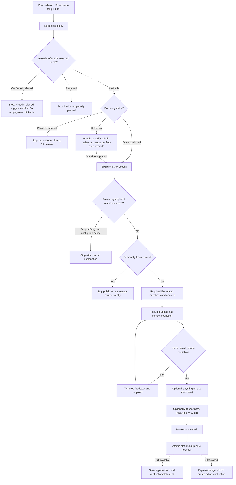
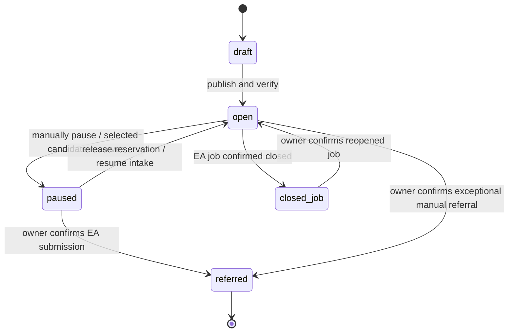
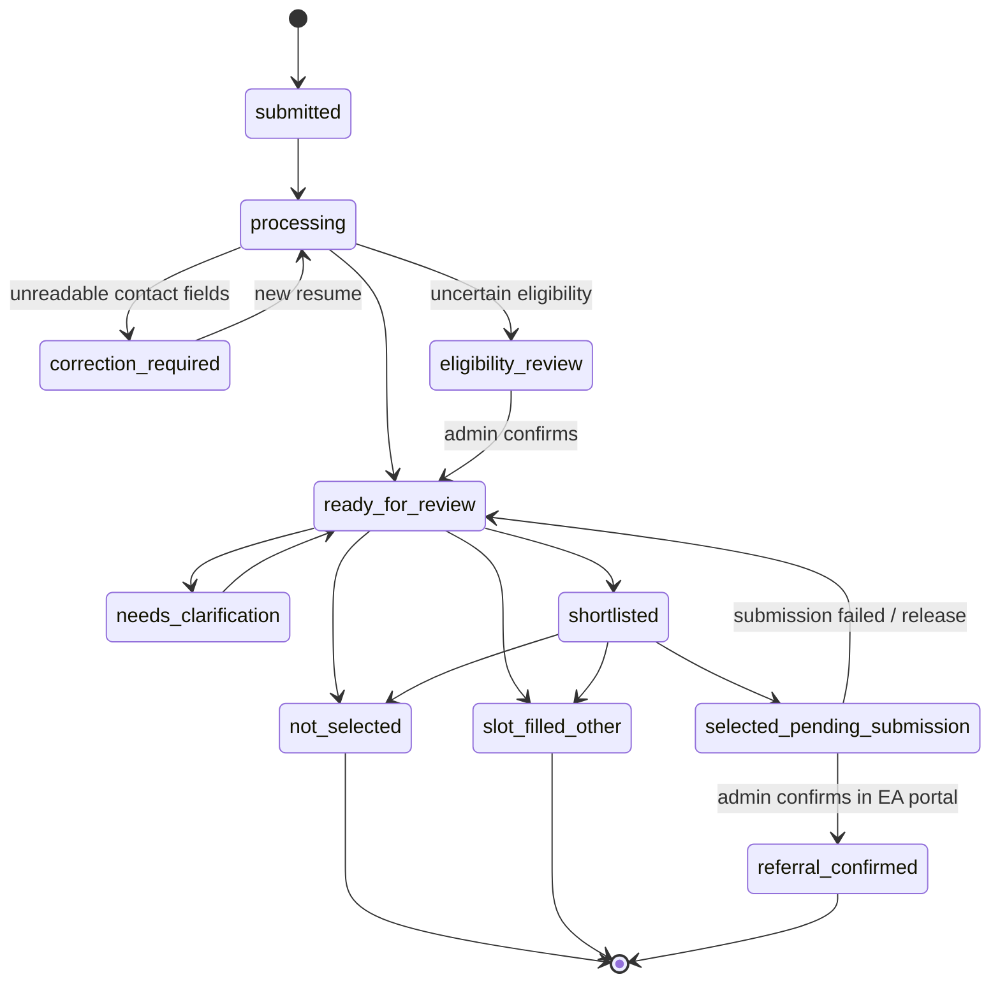
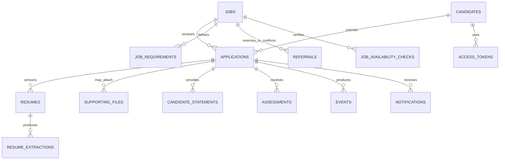

# Personal EA Referral Assistant — Build Specification

**Version:** 1.0 consolidated | **Date:** 24 October 2026 | **Status:** Implementation-ready specification with explicitly flagged external dependencies

**Audience:** Codex / implementing engineer. **Owner:** One EA employee using the application privately. **Product model:** Single-admin personal workflow, not a SaaS, ATS, or EA-owned product.

> **Implementation directive:** Build only the behaviors stated here. Where an EA-specific option list, job-availability interface, or referral policy is not verified, create a configurable/manual fallback. Do not invent EA policy, automate EA submissions, read LinkedIn DMs, or auto-reject based on AI matching.

## 1. Executive summary

The owner receives many LinkedIn requests from people seeking referrals at Electronic Arts (EA). The owner personally chooses to refer only **one candidate per distinct EA job ID**, can receive hundreds of requests, and cannot individually answer everyone. The tool replaces repeated conversations with a candidate-facing URL and an admin review desk. It prequalifies requests, checks if a referral slot is available, checks whether a job is still open when verifiable, ensures resume contact fields are machine-readable, optionally allows candidates to showcase relevant work, uses evidence-based JD matching to support the owner's decision, prepares fields for manual EA referral submission, and sends approved email/status updates to all affected candidates.

**Core outcomes:** (1) candidates learn promptly if the owner cannot refer them; (2) the owner compares candidates based on relevant evidence instead of first-come-first-served; (3) the owner can manually submit one well-prepared referral per job; (4) the remaining applicants receive a clear and respectful explanation.

**Non-goals:** public product/multi-tenancy; candidate-to-company applications; autonomous screening decisions; automatic submission to EA's referral portal; LinkedIn inbox reading/auto-replying; guaranteed hiring predictions; enterprise ATS functionality.

## 2. Decisions and rationales (source of truth)

| ID  | Decision                                                                                                            | Rationale / consequence                                                                                                             |
| --- | ------------------------------------------------------------------------------------------------------------------- | ----------------------------------------------------------------------------------------------------------------------------------- |
| D01 | Single private admin, public intake links                                                                           | Tool exists solely for owner's personal workflow; avoid team roles and SaaS billing.                                                |
| D02 | One **confirmed** referral per canonical job ID; one provisional reservation at a time                              | Matches owner's practice; avoids accidental second referral. Selected != referred.                                                  |
| D03 | Filled referral slot immediately closes intake                                                                      | Do not collect resumes for a role owner cannot refer to; give fast redirect to another LinkedIn contact.                            |
| D04 | Check internal slot first, external EA listing second                                                               | Cheapest and most reliable early exit; do not depend on fragile EA site access when already referred.                               |
| D05 | Job site verification has OPEN/CLOSED/UNKNOWN, never infer CLOSED from HTTP errors                                  | Official careers site may be inaccessible to automation. Allow manually confirmed availability with timestamp.                      |
| D06 | Prior application and prior referral should stop/flag intake per verified EA notice                                 | Recording shows stated ineligibility; maintain policy-configurable stop and manual override, never claim broader unverified policy. |
| D07 | Do not ask 'actively looking for a job' in intake; in manual EA prep default to 'Yes' and show as owner-confirmable | A referral request already signals job interest; avoid redundant friction while preserving portal field mapping.                    |
| D08 | Ask 'Are you in one of the locations listed for this job?', not country as proxy                                    | Directly matches the recorded EA form; candidate country is separate and needed for portal prep.                                    |
| D09 | Relationship matches EA form options; if personally known, direct to owner                                          | Owner wants personally known people to contact them rather than complete public process.                                            |
| D10 | Resume must expose distinct first name, last name, email, phone                                                     | Owner reports EA portal often fails to prepopulate these; request correction/reupload before review.                                |
| D11 | Editable field confirmation does NOT by itself fix resume-readiness                                                 | Need the document itself to be machine readable; local parser success is not an EA guarantee.                                       |
| D12 | 'Anything else you'd like to share?' optional reveal                                                                | Avoid overloading most applicants; offer optional evidence to those who want to provide it.                                         |
| D13 | Optional explanation max **500 characters**; optional links and **multiple** files total <= **10 MB**               | Concise, useful context; bounded upload footprint. All extras can be skipped without penalty.                                       |
| D14 | JD match percent is **evidence coverage heuristic**, not hire/referral probability                                  | Gives fast comparison while remaining auditable; no opaque AI rejection.                                                            |
| D15 | Owner makes all decisions; AI only extracts/summarizes/compares                                                     | Keeps accountability and control with employee; unsupported AI claims marked unknown.                                               |
| D16 | Candidate status page + email notifications, not LinkedIn messages                                                  | No inbox API dependency and no repeated check-in conversations.                                                                     |
| D17 | Referral preparation is copyable data + downloadable resume + editable owner note                                   | Saves manual effort without automating EA portal.                                                                                   |
| D18 | Owner explicitly marks 'Referral confirmed' only after portal success                                               | No false claims of referral success; triggers slot closure and notification preview.                                                |
| D19 | Messages plain, warm, short, direct, first person                                                                   | Reflects owner's everyday writing style; avoid corporate/robotic copy.                                                              |
| D20 | Track funnel and individual early exits                                                                             | Quantifies who visited, failed eligibility, reuploaded resumes, submitted, reviewed, and received updates.                          |

## 3. Actors, permissions and boundaries

**Public visitor:** open job-specific/general referral URL, inspect opening status, fill eligible candidate form. No access to other candidates or admin data.

**Candidate:** applicant identity is verified via email magic link/OTP; may see own status, update a resume when specifically requested, and request data deletion. Do not require password-based account creation.

**Owner/admin:** single allowlisted authenticated account; creates/edits jobs, verifies availability manually, sees candidate PII/resumes, compares evidence, selects/reserves a referral, manually completes EA referral externally, confirms outcome, previews/sends notifications, audits changes.

**Background workers:** extract documents, compare to JD, process emails/retries; never call EA referral submission or LinkedIn outbound APIs.

**Third-party boundaries:** EA careers website = external information source; EA referral portal = manual external action only; email provider = notification transport; LLM = untrusted advisory processor. Explicitly disclose AI processing of application documents as appropriate and minimize data transmission.

## 4. End-to-end flows

### 4.1 Candidate journey



**General link:** candidate provides an official EA job URL/ID; a per-job link prepopulates it. Never require uploading a resume before availability and basic eligibility checks. Capture minimal anonymous funnel events before consent; avoid persistent personal data on blocked flows.

**Handling UNKNOWN job availability:** by default, do not assert open/closed; offer an informational pending screen and an owner-verified override path. For preapproved job links, use manually verified status with configurable TTL. Do not silently block a candidate forever due to EA website errors.

**Known person branch:** wording: 'We know each other! No need to fill this form. Just message me directly and I'll take a look.' This does not reserve a slot or promise referral. Still show 'already referred' first if applicable.

### 4.2 Admin job lifecycle



**Atomic invariants:** maximum one active reservation or confirmed referral per job; distinct jobs keyed by canonical EA identifier; final submission checks current slot state and availability version; closing a role and sending email are separate durable transactions.

### 4.3 Application and messaging lifecycle



Candidate-visible statuses simplify this: Received, Action needed, Eligibility check, Under review, Referral submitted, Referral not available. Never surface ranking, private admin notes, comparisons, or other applicants' data.

### 4.4 Admin referral execution

1. Open a job and see candidate pool sorted/filterable by suitability evidence, status, eligibility, resume readiness.
2. Compare 2–5 applicants side-by-side; inspect match components and primary quoted/source spans. Score never auto-selects.
3. Choose candidate, causing **provisional reservation** and intake pause; existing candidates remain in review state.
4. Open **Referral Prep**: job URL/ID and JD; full candidate form data; validated resume to download; optional attachments; editable AI-assisted professional-fit note; individual copy buttons and copy-all summary; unresolved warnings.
5. Owner opens EA portal and submits manually.
6. Owner clicks **Mark as referred** and confirms job ID, candidate and manual success. On success, write confirmed referral atomically and close slot.
7. Show a send-review modal: 1 successful candidate email, N other applicants email, any people already declined or already notified excluded by default. Admin can preview/edit and approve sending; dispatch asynchronously.
8. Candidate status pages reflect state immediately even if email transport fails; notification retries use idempotency.

## 5. Detailed screen specifications

| ID  | Screen                        | Essential content and actions                                                                                                                     | Empty/error states                                                    |
| --- | ----------------------------- | ------------------------------------------------------------------------------------------------------------------------------------------------- | --------------------------------------------------------------------- |
| C01 | Referral landing / job lookup | Owner identity, disclaimer, official EA URL/ID, job title, listing status, owner's slot status, continuation                                      | Invalid link, closed job, already referred, paused, EA verify unknown |
| C02 | Eligibility / quick checks    | Already applied? already referred? personally know owner? location in listed job locations?                                                       | Clear stop explanation; direct-contact exception                      |
| C03 | Candidate details             | First/last name, email, phone with code, country, current employer/title, relationship, heard-about source; resume upload                         | Inline errors; preview extracted fields, request reupload             |
| C04 | Resume correction             | Exactly which fields not reliably found, example correct formatting, reupload control, version changes                                            | Unreadable PDF, bad format, extractor timeout                         |
| C05 | Optional showcase             | A single question with 'Yes, add something' or 'No, continue'; reveal note max 500, optional URL(s), optional multi-file area only on Yes         | Skip valid; upload validation; remove files; total size meter         |
| C06 | Review & submit               | Job, declared eligibility, confirmed contact, resume status, extras preview, privacy notice                                                       | Slot changed before submit, duplicate application                     |
| C07 | Submission confirmation       | Receipt, expectation that referral is not guaranteed, email status-link notice                                                                    | Email failed: retry/resend                                            |
| C08 | Candidate status              | Simple status, activity timeline, needed action, approved reason, deletion request                                                                | Expired/invalid link, status inaccessible until email verification    |
| A01 | Admin overview                | Total visitors, unique intake starters, eligibility cutoff reasons, resume failures, submits, pending reviews, completed referrals, notifications | Zero traffic, metrics interval, stale tracking                        |
| A02 | Jobs                          | Add/edit JD, job ID and URL, role locations, link, availability evidence, last verified, slot state, pause/close/reopen                           | Cannot verify EA status; duplicate job ID                             |
| A03 | Job workspace                 | Metrics for that job, candidate table, filters/sorts, match %, one-line why, status, warning badges, selections                                   | No applicants, no valid JD, processing pending                        |
| A04 | Candidate detail              | Resume preview/download, extracted fields, JD evidence matrix, optional evidence, admin notes and decision log                                    | AI unavailable, unsupported resume, identity mismatch                 |
| A05 | Compare candidates            | Side-by-side 2–5, JD weights, coverage and citations, clarity about unknown/unsupported                                                           | Insufficient evidence or outdated analyses                            |
| A06 | Referral Prep                 | Portal field mapping, validated resume and supporting docs, individual copy controls, editable fit summary, open EA portal, manual confirmation   | Missing portal fields / eligibility block                             |
| A07 | Notification review           | Previews for referred + remaining applicants, recipient counts, exclude duplicates, approve send, delivery failures                               | Zero recipients, email provider issue                                 |
| A08 | Settings & audit              | Owner authentication, message templates, role defaults, evidence weighting, retention, source options, events, manual override reasons            | Invalid configuration                                                 |

## 6. Exact candidate fields and portal mapping

Recording inspected: `Screen Recording 2026-10-23 at 10.23.04 PM.mov`, EA referral form sample for **Data Science Intern**. Fields with an asterisk visibly marked required in the recorded form are annotated below. **The recording is a sample, not a guarantee all future EA forms are identical.**

| EA referral portal field                                       | Portal required in recording? | Candidate intake?               | Source / handling                                                                                                                                                                      |
| -------------------------------------------------------------- | ----------------------------- | ------------------------------- | -------------------------------------------------------------------------------------------------------------------------------------------------------------------------------------- |
| Candidate First Name                                           | Yes                           | Yes                             | Extract from resume; confirm; must also be extractable from revised resume                                                                                                             |
| Candidate Last Name                                            | Yes                           | Yes                             | Extract and confirm; handle mononyms via manual exception rather than fabricating last name                                                                                            |
| Candidate Email                                                | Yes                           | Yes                             | Extract, syntax validate, candidate verify by email                                                                                                                                    |
| Candidate Mobile Phone Country Code                            | Not visibly marked            | Yes (phone contact)             | Parse international code or ask                                                                                                                                                        |
| Candidate Phone Number                                         | Not visibly marked            | Yes by owner's readiness policy | Extract and confirm; require visible text in resume                                                                                                                                    |
| Current Employer of Candidate                                  | Not visibly marked            | Conditional/optional            | Extract if available; allow confirm/edit for prep                                                                                                                                      |
| Current Position Title of Candidate                            | Not visibly marked            | Conditional/optional            | Extract if available; allow confirm/edit for prep                                                                                                                                      |
| Candidate Country                                              | Yes                           | Yes or confirm extracted        | Separate from 'located in job location' question                                                                                                                                       |
| How did you initially hear about this opportunity?             | Yes                           | Yes                             | Match EA dropdown options, but only **EA's Public Career Page** was visibly confirmed. Other options must be configured from an updated capture, not invented.                         |
| Is candidate in one of the locations listed for this position? | Yes                           | Yes                             | Exact Yes/No; display actual listed locations; if No, follow job-specific policy/flag instead of automatically assuming disqualification                                               |
| Relationship to Candidate                                      | Yes                           | Yes                             | EA options observed/previously identified: Current EA Employee; Customer/Client; Family Member; Former Colleague; Friend; Other; Professional Network. Confirm list before hardcoding. |
| Is candidate actively looking for a job?                       | Yes                           | **No**                          | No redundant intake question; prep shows Yes as presumed by request, owner verifies before copy                                                                                        |
| Professional abilities and/or fit with EA                      | Not visibly marked            | **No mandatory essay**          | Draft from validated evidence and optional showcase; admin edits before manual portal submission                                                                                       |

**Additional intake-only fields:** official EA job URL or job ID; prior EA application for same role (Yes/No/Unsure), prior referral for same role (Yes/No/Unsure), knows owner directly (Yes/No), consent/acknowledgment, optional pitch, optional URLs, optional supporting files. Email and extracted identity are mandatory for status access. Do not ask candidate 'what country are you in' as substitute for EA location question; country still exists only because EA form asks for it.

**Relationship/direct-contact nuance:** display EA-style relationship options plus distinct 'Do we know each other personally / have we worked together?' branch; if Yes, show direct-message redirect. Some candidates may choose Professional Network while personally acquainted. Avoid treating the EA relationship dropdown alone as a reliable proxy for direct contact.

**Important policy boundary:** recorded EA notice about already-applied/already-referred same role should be represented as policy text/version on intake. Configure whether Yes stops or requires owner review after validating current policy; default to stopping with clear reason based on notice. Unsure routes to clarification. Do not imply that candidates cannot apply directly or that a referral is always possible.

## 7. Resume readiness and correction UX

**Order:** Upload PDF or DOCX -> validate MIME/signature/size/malware -> extract text -> identify first name, last name, email, phone -> candidate confirms extracted values -> readiness decision -> proceed or targeted reupload.

**Mandatory owner readiness checks:** distinct first/last name, email, phone must be reliably extractable **from the resume itself**; mere manual typing does not resolve parsing. Preserve correction explanations, new resume versions, and timestamps. A failure to detect is not proof a field is absent.

**Candidate copy example:** 'I couldn't clearly read your phone number from the resume. Could you add it as normal text near your name and email, then upload the updated PDF? This makes it easier for me to fill the referral form.' For name/email adapt exactly to missing field. Avoid 'Your resume is bad'.

**Readiness states:** PASSED; NEEDS_CORRECTION (specific field keys); UNREADABLE; PROCESSING; UNAVAILABLE. Implement retry, OCR only as optional fallback, and admin exceptional override with reason. A pass means local parsing passed, **not** that EA's parser will auto-populate correctly.

**Supporting files:** separate storage/processing from mandatory resume. Candidate optional files cannot compensate for unreadable required contact fields; should not introduce failure into basic eligibility if optional analysis fails.

## 8. Optional showcase — collapsed by default

Exact prompt: **'Anything else you'd like to share?'** Supporting copy: 'Your resume is all I need. But if you have a project or something else that shows why you're a good fit, feel free to add it.' Controls: **'Yes, I'd like to add something'** / **'No, continue with my resume'**.

On Yes only, reveal: (a) 'What would you like me to know?' textarea with max 500 Unicode characters (server and client validated), (b) optional portfolio/GitHub/project URLs (one or more), (c) optional multi-file documents upload with individual remove controls, cumulative size meter, combined maximum 10 MB (10,485,760 bytes), per-file validation. Suggested file types: PDF, DOCX, TXT; allow common safe image formats only if useful for evidence, never executable/archives. Set an app-defined per-file cap as well; total across extras <=10 MB, not counting mandatory resume. (d) compact expandable hints: what you built, your contribution, relevant JD match, measurable results, demo/case study.

Candidate may submit no extras, text only, links only, files only, or combinations. Clicking No should skip storage of extra material. **Never boost the match score for merely opting in**; only substantive JD evidence may affect assessment, and applicant claims must be labeled as such. Candidate skip is not interpreted as lack of seriousness despite the optional opportunity for motivated applicants to demonstrate their fit.

## 9. Job availability verification design

Input: `https://jobs.ea.com/en_US/careers` as source and role-specific links from it. Normalize supported paths and EA job ID (e.g. job-detail trailing numeric identifier when available); preserve original URL, never trust arbitrary URLs (SSRF protection). Different localized URLs or titles for the same EA job ID map to one `jobs` record. For links without an extractable ID, require valid owner mapping or reject with actionable validation.

**Algorithm:**

1. Resolve canonical job ID.
2. Read local `jobs` and `referrals` state transactionally. If confirmed referral, stop with already-referred message. If reserved, show temporarily unavailable.
3. If slot available, read recent verified status cache or attempt supported access to official EA source.
4. OPEN -> allow intake. CLOSED based on reliable explicit source -> stop. UNKNOWN/error/406/inaccessible -> never call it closed; allow owner manual verification/override with timestamp and TTL.
5. Before final application creation, recheck slot in transaction and validate availability confidence/override.
6. Record verification `source`, `checked_at`, `raw_status`, `error`, `expires_at` and status version. Owner sees stale badges.

**External dependency:** Automated EA job verification was not established as reliably accessible during discussion (direct requests failed). Do not build unsupported scraping assumptions. Implement `JobAvailabilityProvider` interface with official-site adapter where permitted and `ManualVerifiedProvider` fallback. Keep verification behind feature flag. Do not expose technical errors to candidates.

**Closure copy — already referred:** 'Hey! Thanks for reaching out. I've already referred someone for this role, and I'm only referring one person per position. Feel free to reach out to someone else at EA on LinkedIn. All the best with your application!' Link to LinkedIn; no new resume intake.

**Closure copy — role not open:** 'Hey! Looks like this position is no longer open on EA's careers site. You can check other openings and send me the link if you find something relevant.' Link to EA jobs home.

**Unknown:** 'I couldn't confirm whether this job is still open right now. I don't want you filling out the form unnecessarily. Please check the EA job page or try again later.' Offer admin-review request without uploading a resume if desired.

## 10. Match comparison, score definition and AI constraints

User explicitly wants a **percent** and one-line 'why' per candidate. Implement an advisory **JD match %** plus evidence completeness/confidence indicators; do not label it 'likelihood of referral' as statistical probability. This is one input into owner's decision.

**Default editable rubric** (job versioned): mandatory JD requirements 45%; directly relevant work/projects 30%; preferred requirements 15%; demonstrated achievements/evidence 10%. Each requirement has weight, source JD span, assessment level (demonstrated, partially demonstrated, unclear, not evidenced), candidate-evidence spans and origin (resume, candidate pitch, portfolio/supporting file). The score is a weighted heuristic over assessment levels; document coefficients in code/tests. 'Not evidenced' != lacks skill. If substantial unknowns, show 'Evidence incomplete' and score range/coverage metric rather than false precision.

**Critical exclusions:** no points for submitting optional extras per se; no deduction for refusing extras; no scoring by personally knowing owner; no automatic filtering based on school prestige or unrelated personal attributes; parsing quality/eligibility shown as independent badges. No automatic AI decision or sending rejection emails without owner confirmation except objective, configured intake stop rules.

Candidate list columns: candidate name, received at, resume readiness, eligibility warnings, experience, JD match %, evidence confidence, one-line rationale, optional evidence badge, admin status, latest update. Filters for job, review state, eligibility, score band, new/updated, resume needs fix; sort descending score or newest by explicit choice. Side-by-side comparison up to five resumes, requirement-by-requirement matrix, evidence links, disagreements/unknowns, owner notes/overrides.

**AI safety/reliability:** structured JSON schema, input versions, model identifier, cited extracted text offsets/page, no invented achievements or eligibility, confidence where applicable, retries and manual fallback. Treat resume instructions as untrusted data; never allow prompting inside a document to execute actions. Audit model/version and admin overrides.

## 11. Metrics dashboard: definition-level requirements

**Aggregate cards:** page views, unique visitors (approx privacy-respecting), started applications, eligibility cutoffs, resumes requiring correction, resumes fixed, completed submissions, pending review, selected, confirmed referrals, notifications successfully delivered, failed deliveries.

**Stage funnel with counts and conversion:** landing -> job recognized -> role open / slot available -> eligibility passed -> started contact/resume -> resume passed -> optional showcase seen/opted in -> submitted -> reviewed -> reserved -> referred. For each edge, show unique sessions at start, passes, exits, drop-offs, % of previous stage and % of initial visitors. Intentional stop reasons separate from abandonment.

**Cutoff reasons:** referral already filled; selected/reserved; official job closed; job availability unknown; prior application; existing referral; personal-contact redirect; job location mismatch/needs review; invalid job ID; extraction failed; validation retries; abandonment; rate-limited/bot.

**Instrumentation events:** `landing_viewed`, `job_submitted`, `job_resolved`, `slot_blocked`, `availability_checked`, `eligibility_answered`, `eligibility_blocked`, `personal_redirect`, `resume_uploaded`, `resume_parse_failed`, `resume_correction_requested`, `resume_reuploaded`, `resume_ready`, `showcase_opened`, `showcase_skipped`, `application_submitted`, `analysis_completed`, `candidate_reviewed`, `candidate_selected`, `referral_confirmed`, `notification_queued`, `notification_delivered`, `notification_failed`, `status_viewed`.

Use session-level anonymous IDs with short retention for pre-consent events; do not count every refresh as another person. A single candidate across several roles is multiple applications but one candidate; report both. Distinguish today's snapshot from historically observed events. Per-job and date-range filtering mandatory.

## 12. Notification UX and templates

Candidate has email-verified status URL (short-lived access token, refresh by verified email). Send after status updates only when material (received, correction needed, request for clarification, referral confirmed, slot filled, not selected). No repeated emails for unchanged state. No direct LinkedIn messaging integration.

**Referree email:**

Subject: Your EA referral is submitted

Hey,

I've submitted your referral for the role at EA.

You should hear from the recruitment team if your profile gets shortlisted. I may not have visibility into every step, so please keep an eye on your email.

All the best!

**Remaining applicants when owner confirmed one referral:**

Subject: Update on your EA referral request

Hey,

Thanks for sharing your profile. I've already referred someone for this position, so I won't be able to refer another person for the same role.

Didn't want to leave you waiting for a response. Feel free to reach out to someone else at EA on LinkedIn, or check other openings.

All the best with your search!

**Resume correction:** 'Hey! I couldn't clearly read [field] from your resume. Could you add it as normal text and upload the updated file? It should make the referral details easier to fill. Thanks!'

**Already referred at intake:** use closure copy in §9; do not ask for email or resume and therefore do not send unsolicited follow-up.

**Delivery flow:** owner previews recipient groups/counts, can edit templates before approve/send; commit status first, queue email outbox, send individually with provider rate limits, idempotent event keys and delivery logs. Exclude already-finalized/notified where appropriate; no disclosure of selected candidate identity to rejected applicants. Different reason for manual decline vs slot fill; never claim resume low quality if it was not reviewed.

## 13. Referral preparation: single-screen specification

Header: job title, canonical EA job ID, official careers URL, job location(s), availability confirmation, slot status, candidate name/status, eligibility warnings. Fields mapped exactly to recorded form:

- First name / last name, email, phone code, phone, employer, position title, country.
- Heard-about-source dropdown value, in-one-of-listed-locations Yes/No, relationship to candidate EA category.
- 'Actively looking for a job' = **Yes presumed from request; admin must confirm** before copying/submitting.
- Professional abilities/fit summary: evidence-based editable paragraph, explicit citation links for owner's verification; never pretend personal endorsement if the owner has not worked with candidate.
- Resume: secure preview and local download link; supporting documents separate; optional pitch/links displayed.
- Individual **Copy** buttons and **Copy all details**; link **Open EA referral portal**. No browser automation or programmatic portal submission.
- Actions: `Reserve slot`, `Release reservation`, `Mark as referred (confirm manually submitted)`, `Unable to submit`, `Request correction`.
- Confirm manual submission prompt with job ID, candidate and irreversible effect to close intake; audit record.

## 14. Logical data model



**Table specifications (minimum):**

| Table                     | Required columns (in addition to PK, created_at, updated_at)                                                                                                                                               | Notes                                                              |
| ------------------------- | ---------------------------------------------------------------------------------------------------------------------------------------------------------------------------------------------------------- | ------------------------------------------------------------------ |
| `admin_users`             | auth_user_id, role                                                                                                                                                                                         | Single allowlisted admin; reject all other logins.                 |
| `jobs`                    | canonical_external_job_id UNIQUE, official_url, title, jd_text, locations_json, jd_version, status, slot_state, availability_status, availability_checked_at, availability_source, availability_expires_at | role URL uniqueness and versioning.                                |
| `job_availability_checks` | job_id, provider, result, source_url, checked_at, error_code, expires_at, manual_override_by, reason                                                                                                       | audit manual/external statuses.                                    |
| `candidates`              | first_name, last_name, normalized_email, phone_e164, country, linkedin_url_optional                                                                                                                        | normalize email; avoid false merges on name alone.                 |
| `applications`            | job_id, candidate_id, status, prior_applied, prior_referred, known_person, in_listed_location, relationship_option, opportunity_source, owner_consent_version, submitted_at, version                       | UNIQUE(job_id,candidate_id).                                       |
| `resumes`                 | application_id, version, private_storage_key, sha256, mime_type, bytes, extraction_status, readiness_status, active                                                                                        | current active resume version; never public bucket.                |
| `resume_extractions`      | resume_id, extractor_version, extracted_json, detected_fields_json, evidence_locations_json, warnings_json                                                                                                 | preserving provenance and parse issues.                            |
| `candidate_statements`    | application_id, note_500, project_urls_json, updated_at                                                                                                                                                    | optional; no scoring bonus for participation.                      |
| `supporting_files`        | application_id, storage_key, mime_type, bytes, sha256, filename                                                                                                                                            | sum bytes <=10 MiB; scan and remove actions.                       |
| `job_requirements`        | job_id, jd_version, criterion, category, weight, source_span, required_flag                                                                                                                                | versioned rubric.                                                  |
| `assessments`             | application_id, resume_version, jd_version, rubric_version, model_name, components_json, match_percent, coverage_percent, one_line_reason, evidence_json, status                                           | immutable history of analyses.                                     |
| `referrals`               | job_id, application_id, status, reserved_at, confirmed_at, released_at, confirmation_note                                                                                                                  | partial UNIQUE(job_id) for `reserved`/`confirmed`; see invariants. |
| `referral_prep`           | application_id, copied_fields_json, owner_fit_note, reviewed_at, last_copied_at                                                                                                                            | snapshot for manual entry.                                         |
| `events`                  | actor_type, actor_id_nullable, job_id_nullable, application_id_nullable, session_id_nullable, event_name, payload_json, event_at                                                                           | analytics + audit distinct or split for security.                  |
| `notifications`           | application_id, type, status, recipient_email, template_version, idempotency_key UNIQUE, provider_id, sent_at, error                                                                                       | durable outbox + delivery state.                                   |
| `access_tokens`           | candidate_id, token_hash, expires_at, consumed_at                                                                                                                                                          | one-time/short TTL; no plaintext persistence.                      |
| `deletion_requests`       | candidate_id, verified_at, processed_at, status, audit_reference                                                                                                                                           | data erasure workflow.                                             |

**Data integrity:** SQL transaction/advisory/row lock for per-job slot changes; unique active referral index; defensive application submission recheck; referential integrity; stored timezone-aware timestamps; encrypted secrets; tenant isolation not needed but admin-only RLS plus restricted candidate access via verified token server endpoints; storage signed URLs.

**Suggested canonical job ID:** source-specific `EA:<numeric-id>`; never merge based on title alone. If portal job ID vs careers ID differ, maintain explicit mapping table.

## 15. API and service contracts (proposed, not fixed URL mandates)

| Method | Endpoint                               | Function and auth                                                                         |
| ------ | -------------------------------------- | ----------------------------------------------------------------------------------------- |
| POST   | `/api/jobs/resolve`                    | Public; validate EA URL/ID, local slot, official availability, report reason; rate-limit. |
| POST   | `/api/intake/check`                    | Public; eligibility flags, known-person redirect, validation; minimal data.               |
| POST   | `/api/uploads/resume`                  | Candidate verified transient session; safe signed upload and extraction job.              |
| POST   | `/api/resumes/:id/validate`            | Server job; structured extraction and readiness.                                          |
| POST   | `/api/applications`                    | Candidate; idempotent atomic create + slot recheck.                                       |
| POST   | `/api/status/access`                   | Candidate; email-verified magic link/OTP; rate-limit.                                     |
| GET    | `/api/status`                          | Authorized candidate token; own status only.                                              |
| GET    | `/api/admin/metrics`                   | Owner only; date/job filters, events + counts.                                            |
| POST   | `/api/admin/jobs`                      | Owner; create/update/version jobs, external verification.                                 |
| GET    | `/api/admin/jobs/:id/applications`     | Owner; filters, score, evidence.                                                          |
| POST   | `/api/admin/applications/:id/decision` | Owner; note and audit state transition.                                                   |
| POST   | `/api/admin/referrals/reserve`         | Owner; unique slot reservation.                                                           |
| POST   | `/api/admin/referrals/confirm`         | Owner; explicit manual EA success, close job.                                             |
| POST   | `/api/admin/notifications/preview`     | Owner; compute recipient groups and templates.                                            |
| POST   | `/api/admin/notifications/send`        | Owner; persist outbox then background email.                                              |

All mutations require authorization, server-side schema validation, version preconditions or idempotency keys. Public endpoints must not return another applicant's existence/details. Maintain simple typed contracts using Zod/OpenAPI.

## 16. Edge cases & behavior table

| Case                                            | Behavior                                                                                                  |
| ----------------------------------------------- | --------------------------------------------------------------------------------------------------------- |
| Referrals already confirmed for job             | Stop on page load, suggest contacting another EA employee on LinkedIn; collect no resume.                 |
| Candidate opens URL with stale job ID           | Validate canonical ID, show actionable correction.                                                        |
| EA site blocked / 406 / timeout                 | UNKNOWN, not CLOSED; manually verified-open fallback, technical details admin-only.                       |
| Job closed while form is open                   | Recheck at final submit, stop; clean temporary upload after TTL.                                          |
| Two people submit simultaneously                | Allow both only if slot open at commit; duplicate guards independent.                                     |
| Admin selected a candidate but hasn't submitted | Reserve slot, pause new intake; status does not say 'referred'.                                           |
| EA portal rejects referral                      | Release reservation, record reason, resume intake manually if appropriate.                                |
| Admin accidentally confirmed                    | Explicit correction with reason and audit; do not silently rewrite sent communications.                   |
| Already applied or referred per EA notice       | Display clear reason and stop under confirmed policy; unknown leads to owner clarification.               |
| Candidate location answer No                    | Display job locations; route per admin-defined rule; do not assume country mismatch or blanket rejection. |
| Personally knows owner                          | Show direct contact path; do not continue public form, but slot check still first.                        |
| One-part name                                   | Parsing cannot invent family name; admin exception path, candidate instruction.                           |
| Resume images/scanned/no contact text           | Field-specific reupload; optional OCR cannot promise EA parser success.                                   |
| Phone manually typed but missing from resume    | Not ready; explain why reupload required.                                                                 |
| Resume replacement after analysis               | Supersede current extraction, invalidate assessment, queue fresh processing.                              |
| Optional attachment >10 MiB total               | Block extras only, show cumulative size and remove controls; resume unaffected.                           |
| Candidate skips optional proof                  | No score penalty or extra friction.                                                                       |
| AI has low evidence confidence                  | Show unknown/evidence incomplete; allow manual review.                                                    |
| Candidate submits twice for same role           | Open existing application/status after email verification; no duplicate.                                  |
| Same candidate applies multiple roles           | Shared identity, role-specific application and JD matching.                                               |
| EA job title or JD changed                      | Version JD, invalidate stale assessments, display stale badge.                                            |
| Candidate email bounces                         | Retry limited, flag owner, status page remains canonical.                                                 |
| 500 existing candidates on slot confirmation    | Close slot atomically and send outbox in batches; no long synchronous request.                            |
| Candidate asks for deletion                     | Verify requester, delete eligible docs/PII and retain minimal pseudonymous audit as lawful.               |
| Uploaded file contains adversarial instructions | Treat as data, never change decisions or trigger tools.                                                   |
| Admin pastes fake careers URL                   | Strict allowlist for EA domains and path; prevent SSRF and phishing links.                                |
| Person asks if referral guaranteed              | Explicit 'not guaranteed' on public form and status.                                                      |

## 17. Privacy, security and operational safeguards

Implement: dedicated owner auth + MFA if available; email-verified applicant status; short-lived tokens; private object storage; validation of file extensions, MIME _and magic bytes_; AV/malware scan; file upload rate limits, CSRF/origin checks; structured validation; antivirus/sandbox handling; PDF/docx extraction timeout, decompression bomb protection; content-sanitized previews; encrypted provider credentials; audit trail of owner actions; short-lived signed URLs; error monitoring and backups; data retention policy with candidate deletion workflow. Avoid logging resume contents or email tokens. Allow admin to configure default deletion e.g. 90 days after job closure, subject to applicable legal requirements. Publish privacy/AI processing notice before upload.

Email: verified outbound domain, provider webhooks, spam/bounce handling, per-recipient send logging, idempotency. Distinguish confirmed admin status from email delivery state. Throttle bulk notifications, opt-out for nonessential communications; transactional status messages only.

Job verification: respect official website access policy, never claim status from stale search index or HTTP error; manual workflow always available.

## 18. Acceptance criteria — executable tests

**Eligibility:** confirmed referred job shows stop without resume upload; reserved job shows pause; closed job stops; unknown official status shows unresolved/manual route, not false closed; prior-referral questions route to policy-correct message; known-person branch exits to direct contact; URL normalization maps same job ID across locales.

**Resume:** missing first name/last name/email/phone yields specific correction; typed contact field alone doesn't clear readiness; corrected resume invalidates previous extraction; unsupported file, malicious file and excessive sizes blocked; OCR failure doesn't lose applicant submission draft; locally readable disclaimer appears.

**Showcase:** collapsed by default; No skips; Yes reveals 500-char text, optional links, files; allows text/files/both/neither; 501 chars rejected server side; aggregate files >10 MiB rejected; individual remove reduces meter; skip never affects match score.

**Review:** percent comes from documented criteria; one-line reason tied to evidence; unsupported work claims flagged; comparing candidates does not leak info; admin only can reserve or refer; one active slot invariant holds under concurrent requests; external EA submission is never attempted programmatically.

**Communication:** magic link cannot access others' data; owner previews counts/templates; after manual confirmation selected candidate gets accurate confirmation and other nonfinal applicants get slot-filled notice; retries are idempotent; status updates persist even if sending fails.

**Analytics:** funnel counts track unique sessions vs pageviews; drop-offs vs intentional stops separate; stage counts reconcile with events; per-job/date filters; blocked before PII collection counted anonymously only.

## 19. Phased implementation plan / Codex tasks

**Phase 0 — Repository & decision fixtures.** Next.js + TypeScript, Tailwind/shadcn/ui, Supabase local/remote setup, migrations, typed Zod schemas, test stack, owner authentication, `.env.example`, README. Seed 3 fake roles and candidates (never use real recording PII). Establish config for EA source options and policy controls. Deliver architecture docs and CI.

**Phase 1 — Job availability & intake.** Canonical job resolver, slot check, job CRUD, provider interface + manual availability fallback, applicant public page and early exits; instrument events; integration tests for availability unknown/races.

**Phase 2 — Resume intake & optional showcase.** Secure file intake, extraction and contact checks, reupload feedback and versions, conditional 500-char extras and cumulative <=10 MiB uploads, final submission, email verification/status page.

**Phase 3 — Evidence and dashboard.** JD rubric parsing/versioning, scoring with documented weights, evidence citations, candidate list filters and comparisons, admin metrics funnel, audit, AI-failure states.

**Phase 4 — Manual referral & messaging.** Portal prep screen with copy/download, owner-authenticated reserve/confirm transitions, preview-and-approve email batches, templates, outbox/retries, candidate status updates.

**Phase 5 — Production hardening & pilot.** Accessibility/responsiveness, security review, file scanning, limits, deletion/retention, concurrency/load tests (hundreds of applicants), provider verification behavior, observability, deploy and limited real-user pilot.

**Definition of done per phase:** code, DB migration, unit + integration tests, responsive UI states, documented config changes, local demo with seeded fake data; no reliance on unfinished external integrations.

## 20. Non-functional targets and measurable success

Suggested (targets to validate, not guarantees): applicant basic intake <=2–3 minutes excluding resume edits; early-exit feedback within typical request latency; owner quick scan <30 seconds per candidate once processed; consistent single-slot invariant; at least one understandable status for 100% of completed submissions; zero automatic EA portal submissions; support 500+ applications/job without synchronous analysis bottlenecks; automated tests for all P0 rules; accessible keyboard/mobile applicant experience. Metrics: time to useful answer, resume correction completion, submission completion, admin review time, percentage who get status, successful notification delivery, owner estimated hours saved.

## 21. External dependencies and open verification items — do not fabricate

1. **EA opportunity source dropdown:** only 'EA's Public Career Page' visibly confirmed in recording; capture full dropdown options or provide admin-configurable list.
2. **Relationship dropdown:** seven options listed above were identified in earlier review, but should be rechecked against current live EA form before mapping rigidly.
3. **EA policy:** sample notice says already-applied or already-referred same-role candidates ineligible; current detailed restrictions and exception rules must be confirmed. Job location answer behavior should likewise remain configurable.
4. **Official EA open-job API:** no reliable general automated status endpoint verified; implement adapter + manual status, not silent scraping.
5. **One referral per role:** owner's chosen practice; do not describe as confirmed EA-wide policy.
6. **EA parser compatibility:** local resume field extraction can highlight likely issues but cannot certify EA's auto-population behavior.
7. **Email and LLM providers:** configurable per environment; no vendor lock-in required in MVP.

## 22. Suggested repository layout

```text
app/
  (public)/referral/[jobId]/page.tsx
  (public)/referral/page.tsx
  (public)/status/page.tsx
  (admin)/admin/{dashboard,jobs,jobs/[id],candidates/[id],settings}/...
  api/{jobs,intake,uploads,applications,status,admin}/...
components/{candidate,admin,shared}/
lib/
  auth/  db/  jobs/{normalize,availability}/
  intake/  resume/{extract,readiness}/
  assessment/{rubric,score,evidence}/
  notifications/{outbox,templates}/
  validation/  analytics/  storage/
supabase/migrations/
tests/{unit,integration,e2e}/
docs/{decisions,contracts,runbooks}/
```

## 23. First Codex instruction — copy verbatim into coding session

> Read `EA_Referral_Assistant_PRD.md` entirely and treat it as the source of truth. This is a single-admin personal EA referral tool. Begin with Phase 0 and Phase 1 only, and create a working Next.js + TypeScript + Supabase project, migrations, app shell, admin auth, job management, public job link, internal referral-slot check, mockable EA job-availability provider with a manual verified-open fallback, and intake eligibility stop messages. Seed fictional data. Include unit/integration tests and a short README with local setup steps. Do not automate EA portal submission, invent EA dropdown options, claim that HTTP errors mean jobs are closed, or build a multi-tenant SaaS. Show the file tree, design tradeoffs and how to run/tests; when a detail is unverified, isolate it in typed configuration. Preserve the documented phase boundaries and use follow-on tasks for later phases.

---

### Reference links

- Official EA careers: https://jobs.ea.com/en_US/careers
- EA careers landing: https://www.ea.com/careers
- LinkedIn: https://www.linkedin.com/

### Provenance note

Consolidated from the complete conversation and the supplied EA manual-referral recording. Illustrative UI samples and scores discussed in chat are examples, not observed operating metrics. No real candidate resumes or contact information are reproduced in this specification.
